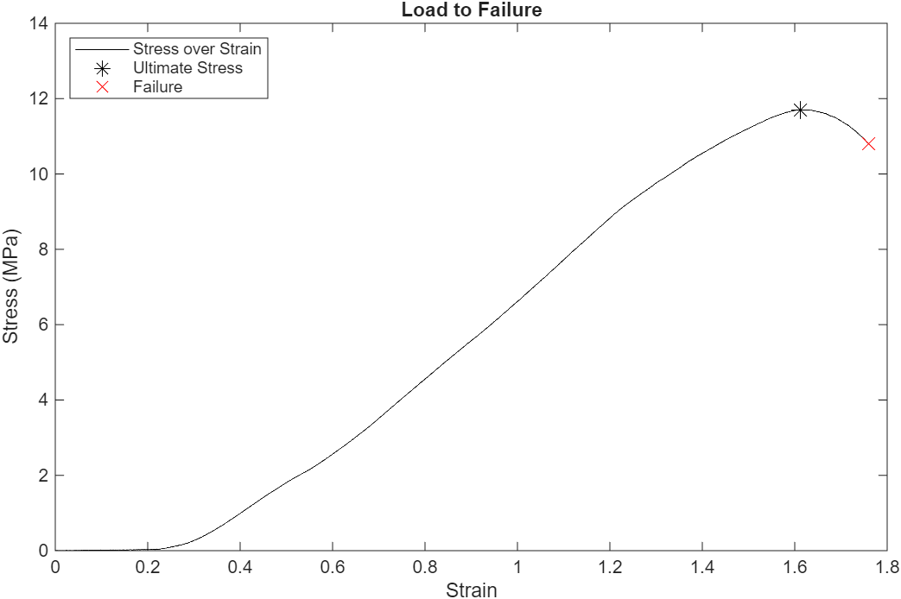
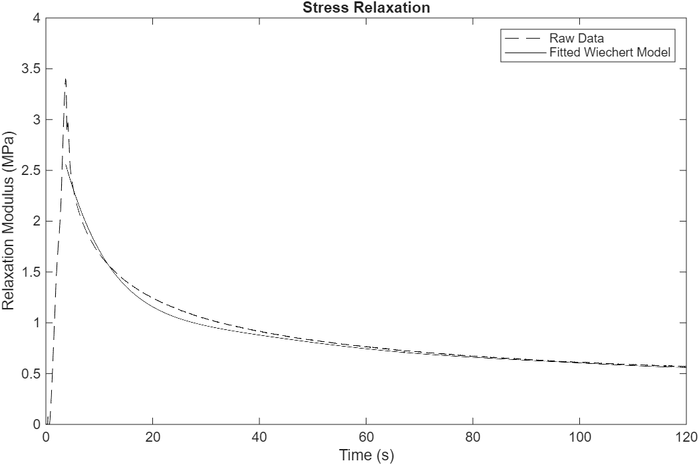

# Purpose
This repository analyzes the elastic and viscoelastic properties of chicken femur cartilage. Elastic properties of the specimen underwent a load to failure test, the data of which was plotted and analyzed. The viscoelastic properties were fitted to a computationally determined Weichert model, the accuracy of which was then compared with that of the experimentally obtained data. This repository was created thanks to the data obtained from the final project of my Biomechanics class.

# How to Use this Repository
## Requirements
This repository requires MATLAB.

## Setup
To use this repository, simply run the "main.m" file in MATLAB. The scripts will read the spreadsheets in the "Data/" folder and will display the created graphs, and output the computed equation of relaxation modulus from the Weichert model as well as the accuracy of the fitting in .txt files in the "Output/" folder. To change the parameters, modify the variables in the "Input" section of "main.py", such as the number of desired terms in the Weichert model.

# Output
This section contains the output graphs for the default parameters of this model.

Below is the output graph for the load to failure test. In this graph, stress is plotted with respect to strain, with the maximum stress and failure points labeled:

Below is the output graph for the Stress_Relaxation test. In this graph, relaxation modulus is plotted with respect to time for both the experimentally obtained values as well as the computed Weichert model of the data:

Also included in the "Output" folder are text files containing the computed equation from the Weichert model and the results of the statistics tests run on this data.

# Background
Load to failure and stress relaxation tests were performed on a sample of chicken femur cartilage to determine the elastic and viscoelastic properties of the specimen. Load to failure measured the elastic properties by determining the stress (force normalized by cross sectional area) the specimen exerted in response to an applied strain (displacement normalized by the initial length). Stress relaxation measured the viscoelastic properties by determining the relaxation modulus (proportional to stress and force) over time when the specimen was held at a constant strain. In the calculations in these scripts, area refers to the area of the indenter tip used to apply stress on the specimen, and cartilage depth refers to the initial depth/length of the specimen for the purposes of calculating strain. 

For the stress relaxation test, the normalized force, displacement, and time data were inputted. The maximum displacement was pulled and converted to strain to serve as the constant strain for the test. Force, area, and strain were used to calculate the relaxation modulus in comparison to the Weichert model. For the Weichert model, 7 experimentally acquired relaxation modulus values and the time points at which they occurred, evenly spaced apart beginning at the point of maximum force, were inputted into the Weichert model. Note that the number of terms is configurable in the "Inputs" section of "main.m". The Weichert model set up and solved a system of 7 linear equations, solving for 7 relaxation moduli constants, representing a Weichert model with 1 spring in parallel with 6 Maxwell elements, a model of viscoelasticity where the spring is the elastic component and the the Maxwell elements are viscoelastic components. The following is the Prony series representing the Weichert model: $E\left(t\right)=E_0+\sum _{i=1}^NE_i\cdot e^{-\frac{t}{\tau _i}}$, where $E_0$ represents the spring constant, $E_i$ represents one of the Maxwell elements, and $\tau_i$ represents the time point corresponding to the ith relaxation modulus value pulled from the experimental data. Here is the 7-term fully expanded form of this series: $E\left(t\right)=E_0+E_1\cdot e^{-\frac{t}{\tau _1}}+E_2\cdot e^{-\frac{t}{\tau _2}}+E_3\cdot e^{-\frac{t}{\tau _3}}+E_4\cdot e^{-\frac{t}{\tau _4}}+E_5\cdot e^{-\frac{t}{\tau _5}}+E_6\cdot e^{-\frac{t}{\tau _6}}$. These constants were used to numerically generate relaxation modulus over time plots to compare with the experimentally acquired data. The Weichert model used in these scripts was adapted from the related paper by Machiraju et al.1

Statistical analysis of the stress relaxation data served to compare the accuracy of the Weichert model to the experimentally acquired data. The standard deviation of the difference between the Weichert model and the experimental data was computed as a general measure of the deviation between the data and model. Next, the percent error was calculated to represent the accuracy of the model to the data. The R2 value was then computed between the model and data using MATLAB’s “corr” function, representing the significance of the correlation between the model and data.

For the load to failure data, the normalized force and displacement were inputted and converted to stress and strain. The ultimate stress was identified and plotted as the maximum stress that occurred during the plot. The failure point was identified and plotted as the point where the first derivative was most negative, or in other words, the point of steepest decent of the stress vs strain plot.

# Limitations
The results of the Weichert model with the default parameters suggest a fairly high degree of accuracy, with a percent error between the model and data of 3.07% and correlation of 0.993. However, the Weichert model does tend to blow up when adding too many parameters to the model. 7 terms was experimentally determined to be the optimal number for generating a model for the given data, where fewer terms reduced the accuracy, and too many risked breaking the model. Discretion with the number of terms for this model is advised. Notably, the stress vs strain plot for the given data shows strain that exceeds 1. This is highly unlikely to be accurate, since a strain of 1 indicates a displacement of 100%. Since most materials reach their failure point far before this point, this likely indicates error. Since the calculations to generate this plot are fairly straight forward, this error likely stems from incorrect configuration settings when measuring the data, such as incorrectly measuring the initial displacement.

# References
[1] Machiraju, C., Phan, A. V., Pearsall, A. W., and Madanagopal, S., 2006, "Viscoelastic Studies of Human Subscapularis Tendon: Relaxation Test and a Wiechert Model," Comput. Methods Programs Biomed., 83(1), pp. 29–33. doi:10.1016/j.cmpb.2006.05.004. 